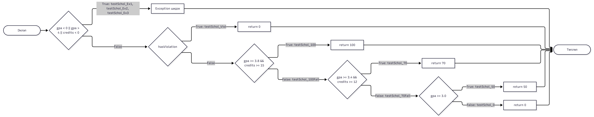

Лаборатори 9: Код хамралт — JaCoCo-гоор тестээ хөтлөх

Овог нэр: Н.Баярбаясгалан
Оюутны код: B242270012

Java хувилбар:
openjdk 17.0.20.1 2026-08-18
OpenJDK Runtime Environment (build 17.0.20.1+1-1-26.04-Ubuntu)
OpenJDK 64-Bit Server VM (build 17.0.20.1+1-1-26.04-Ubuntu, mixed mode, sharing)

Maven хувилбар:
Apache Maven 3.9.12
Maven home: /usr/share/maven
Java version: 17.0.20.1, vendor: Ubuntu, runtime: /usr/lib/jvm/java-17-openjdk-amd64
Default locale: en, platform encoding: UTF-8
OS name: "linux", version: "6.18.33.2-microsoft-standard-wsl2", arch: "amd64", family: "unix"

Хэсэг A: Эхний хамралт ба ажиглалт

Хэвийн урсгалын тестүүдээр эхний хэмжилт хийхэд `results/jacoco-A.csv` файлд Branch хамралт `20/41` (BRANCH_COVERED=20, BRANCH_MISSED=21, ~48.78%), Line хамралт `16/25` (LINE_COVERED=16, LINE_MISSED=9, 64.00%), Instruction хамралт `103/152` (INSTRUCTION_COVERED=103, INSTRUCTION_MISSED=49) гарсан.
HTML тайланг нээж харахад огт ажиллаагүй буюу exception шиддэг замууд улаан өнгөөр харагдаж байсан. Харин `&&` болон `||` логик нөхцөлүүдийн зөвхөн нэг тал нь биелсэн салаанууд шар ромбо тэмдэгтэйгээр хагас хамрагдсан байлаа.

Хэсэг B: CFG ба Branch 100% хамралт

`scholarship()` функцийн ажиллах урсгалыг харуулсан CFG-г зурж, ирмэг бүр дээр бодит тест методын нэрсийг (`testSchol_Ex1`, `testSchol_Ex2`, `testSchol_Ex3`, `testSchol_Viol`, `testSchol_100`, `testSchol_100Fail`, `testSchol_70`, `testSchol_70Fail`, `testSchol_50`, `testSchol_0`) буулган `cfg.png` нэрээр байршуулсан.
`mvn-verify-B.txt` тайланд нийт `Tests run: 20` ажиллаж, тестүүд болон `score > 100` салааг бүрэн нэмсний дараа `results/jacoco-B.csv` дээр `BRANCH_MISSED = 0` (`41/41` branch хамрагдсан) болон `LINE_MISSED = 0` (`25/25` line хамрагдсан) болж 100% хамралт хангагдсан.

Хэсэг C: Давталтын заагийн тестүүд

`gpa()` функц доторх давталтыг шалгахын тулд 0 удаа (`testGpa_Loop0_Null`, `testGpa_Loop0_Empty`), 1 удаа (`testGpa_Loop1`), болон 2-оос дээш удаа (`testGpa_Loop2Plus`) ажиллах заагийн тестүүдийг бичсэн.
Эдгээр тест нь кодын branch болон line хамралтыг шинээр нэмэгдүүлэхгүй ч давталт огт ажиллахгүй үед буруу/хоосон оролтыг хэрхэн барьж буй болон олон давталтын нийлбэр, дундаж тооцоолол зөв эсэхийг баталгаажуулахад зайлшгүй шаардлагатай.

Хэсэг D: Үл үзэгдэгч алдаа ба гол дүгнэлт

60 онооны зааг утгыг шалгасан `ScholarshipCalculatorTest.testLetterGrade_D_Boundary` тест ажиллахад `results/mvn-test-D-fail.txt` дээр `expected: <D> but was: <F>` алдаа гарсан (`Tests run: 21, Failures: 1`). Код дахь `score > 60` нөхцөлийг `score >= 60` болгон засаж тусдаа commit (`Fix letterGrade: > 60 -> >= 60, spec says 60 is D`) хийсний дараа `results/mvn-verify-final.txt` дээр `Tests run: 21, Failures: 0, Errors: 0` болж, `results/jacoco-final.csv` дээр `BRANCH_MISSED = 0` ба `LINE_MISSED = 0` хэвээр хадгалагдсан.

Лабын гол дүгнэлт:
Branch хамралт 100% байсан ч `score > 60` болон `score >= 60` нөхцөлүүд нь ижилхэн салаа үүсгэдэг тул яг `60` зааг утгыг шалгаагүй тохиолдолд энэ алдаа илрэхгүй үлддэг. Код хамралт нь тухайн мөр ба салааг тест ажиллуулах үед дайрч өнгөрсөн эсэхийг л хэмждэг болохоос биш, харьцуулах оператор болон логик нь спецификацийн шаардлагатай яг нийцэж байгаа эсэхийг баталдаггүй. Иймд `score > 100` гэх мэт бүх салааг гүйцээхээс гадна зааг утгын (`boundary value`) тестүүдийг заавал хослуулан бичих нь бодит алдааг илрүүлэхэд шийдвэрлэх ач холбогдолтой.

(AI ашиглалт: Даалгаврын явцад `mvn` болон `jacoco.csv` гаралтын шинжилгээ, `ScholarshipCalculatorTest.java` тестүүдийг өргөтгөх, `cfg.png`-ийн Mermaid бүтэц гаргах болон `README.md`-ийн зөрүүг засахад Gemini AI туслахыг ашигласан.)
