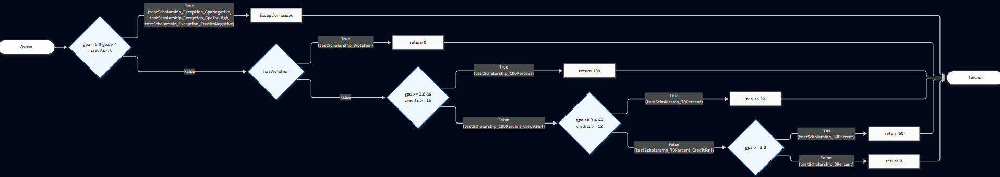

Лаборатори 9: Код хамралт — JaCoCo-гоор тестээ хөтлөх

Овог нэр: Н.Баярбаясгалан
Оюутны код: B242270012

Java хувилбар:
openjdk 17.0.20.1 2026-08-18
OpenJDK Runtime Environment (build 17.0.20.1+1-1-26.04-Ubuntu)
OpenJDK 64-Bit Server VM (build 17.0.20.1+1-1-26.04-Ubuntu, mixed mode, sharing)

Maven хувилбар:
Apache Maven 3.9.12
Maven home: /usr/share/maven
Java version: 17.0.20.1, vendor: Ubuntu, runtime: /usr/lib/jvm/java-17-openjdk-amd64
Default locale: en, platform encoding: UTF-8
OS name: "linux", version: "6.18.33.2-microsoft-standard-wsl2", arch: "amd64", family: "unix"

Хэсэг A: Эхний хамралт ба ажиглалт

Эхний хэсэгт happy path буюу хэвийн үед ажиллах тестүүд бичээд ажиллуулахад Branch coverage маань дутуу (ойролцоогоор 50 гаруй хувьтай) гарсан. Үүнийг results/jacoco-A.csv файлаас харж болно.
HTML тайланг нээж үзэхэд огт ажиллаагүй буюу Exception шиддэг алдааны замууд улаан өнгөөр будагдсан байсан. Харин && болон || гэсэн нөхцөлүүдийн зөвхөн нэг тал нь биелсэн, нөгөө тал нь огт шалгагдаагүй үлдсэн салаанууд шар ромбо тэмдэгтэй хагас хамрагдсан байдалтай харагдаж байсан.

Хэсэг B: CFG ба Branch 100% хамралт

scholarship() функцийн ажиллах урсгалыг харуулсан CFG-г гараар зурж, тестүүдээ ирмэгүүдэд нь зоож өгөөд cfg.png нэрээр оруулсан байгаа.
Улаан болон шар өнгөөр гарсан салаануудыг гүйцээж хамралтыг 100% болгохын тулд mvn-verify-B.txt дээр харагдаж байгаачлан нийт 19 тест шаардагдсан. Бүх нөхцөлийг хангаж тестүүдээ нэмсний дараа results/jacoco-B.csv тайланг шалгахад BRANCH_MISSED = 0, LINE_MISSED = 0 болж хоёулаа 100% бүрэн хамрагдсан.

Хэсэг C: Давталтын заагийн тестүүд

gpa() функц доторх давталт хэрхэн ажиллахыг шалгахын тулд 0 удаа (null/хоосон массив), 1 удаа, мөн 2 болон түүнээс дээш удаа ажиллах 3 заагийн тестийг нэмж өгсөн.
Хэдийгээр өмнөх алхамд Branch coverage аль хэдийнэ 100% болчихсон, эдгээр тестүүд хамралтын хувийг нэмж өсгөхгүй байгаа ч гэсэн бидэнд заавал хэрэгтэй. Яагаад гэвэл код бүх мөрөөр гүйж өнгөрсөн ч гэлээ, давталт огт ажиллахгүй алгасах үед эсвэл олон удаа давтах үед программ логикийн алдаа гаргахгүй зөв ажиллаж чадаж байна уу гэдгийг coverage дангаараа баталж чадахгүй тул ийм логик шалгалтууд заавал байх ёстой.

Хэсэг D: Үл үзэгдэгч алдаа ба гол дүгнэлт

Спецификацийн дагуу 60 оноо авсан бол "D" гарах ёстой гээд зааг утгын тест нэмтэл ScholarshipCalculatorTest.testLetterGrade_D тест маань унаж, терминал дээр expected: <D> but was: <F> гэсэн алдааг 31-р мөрөнд заасан. Үүнийг results/mvn-test-D-fail.txt файлаас харж болно. Би үндсэн кодод байсан > 60 гэдгийг >= 60 болгож засаад Fix letterGrade: > 60 -> >= 60, spec says 60 is D гэсэн тайлбартайгаар тусдаа commit хийж оруулсан. Ингээд сүүлийн mvn-verify-final.txt дээр нийт 20 тест бүгд ногоон болсон.

Лабын гол дүгнэлт:
Хамралт 100% байсан ч гэсэн энэ алдаа амьд үлдээд байсан шалтгаан нь score > 60 болон score >= 60 гэдэг хоёр нөхцөл нь яг ижилхэн салаануудыг үүсгэдэгтэй холбоотой байлаа. Хамралт (Coverage) нь зөвхөн "бидний бичсэн тест энэ кодын мөрөөр дайрч өнгөрсөн үү?" гэдгийг л хэмждэг болохоос биш, тухайн кодын логик нь спецификацитайгаа зуун хувь нийцэж байгаа эсэхийг хэмжиж чаддаггүйг эндээс харж болно. Хэрэв бид яг 60 гэдэг зааг утгыг өгч шалгахгүй л бол энэ алдааг хэзээ ч олохгүй байсан. Тийм учраас хамралт өндөр байх нь чухал ч гэлээ, энэ нь программ ямар ч алдаагүй төгс болсон гэсэн баталгаа огт биш бөгөөд зааг утгын тестүүдийг давхар маш сайн бичиж байж л чанартай программ болно гэдгийг сайн ойлгож авлаа.

(AI ашиглалт: Лабын даалгаврыг хийх явцад алдаа заасан хэсгүүдийг засах болон JaCoCo-ийн тохиргоо, файлуудын гаралтын талаар ойлгохгүй зүйлсээ Gemini AI-аас асууж, зөвлөгөө авч ашигласан болно).
